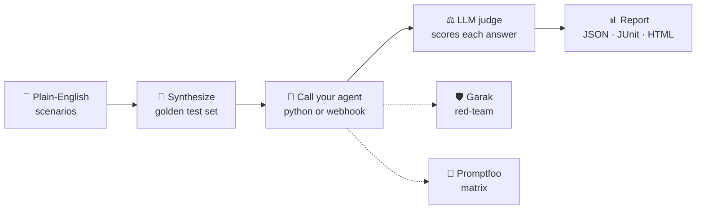

<div align="center">

# 🧪 Quantra CLI

### Describe your agent's world in plain English. Get a test suite. Get a verdict.

Turn plain-English scenarios into a **golden test set**, then score any AI agent against it
with a **configurable LLM judge**, with optional **Prompt Evaluations** and **Adverse Tests** integrations.


</div>

---

## 📖 Table of contents

- [Why Quantra](#-why-quantra)
- [How it works](#-how-it-works)
- [Project status](#-project-status)
- [Quick start](#-quick-start)
- [Configuration](#%EF%B8%8F-configuration)
- [Commands](#-commands)
- [Exit codes](#-exit-codes)
- [Architecture](#-architecture)
- [Development](#-development)

---

## 💡 Why Quantra

Testing an AI agent is awkward. Writing test cases by hand is slow, scoring free-form answers needs
a judge, and every team ends up gluing together the same tools. Quantra is one command-line tool
that covers the whole loop:

| You want to...                              | Quantra gives you                                                      |
| ------------------------------------------- | ---------------------------------------------------------------------- |
| 🗣️ Start from *situations*, not test cases  | Scenario-first flow: say what the agent must handle, get goldens       |
| ⚖️ Score answers that have no exact match   | An LLM judge built on [DeepEval](https://github.com/confident-ai/deepeval) metrics |
| 🔌 Test any agent                           | A Python callable or any OpenAI-style HTTP webhook                     |
| 🔁 Swap judges freely                       | OpenAI, Anthropic, or a local model (Ollama / HuggingFace)             |
| 🛡️ Probe for vulnerabilities                | Optional [Garak](https://github.com/NVIDIA/garak) red-team scans       |
| 📊 Compare agents side by side              | Optional [Promptfoo](https://www.promptfoo.dev/) matrix runs           |
| 🚦 Gate your CI                             | Stable exit codes and JSON / JUnit / HTML reports                      |

## 🔭 How it works



1. **Describe.** Write scenarios such as *"Test refund policy edge cases for premium users."*
2. **Synthesize.** Quantra enhances each scenario and generates golden cases under `./goldens/`.
3. **Run.** Each case goes to your agent; the judge scores the answer with metrics like answer
   relevancy or your own custom rubric. Multi-turn conversations are supported too.
4. **Report.** Results land in `./reports/` and the process exit code tells your CI what happened.

Everything is driven by **one merged settings object**, so the same option can come from a flag,
an environment variable or a YAML file, in that order of priority.

## 🚧 Project status

Quantra is under active development. The design lives in the Technical Design Document, and work
is tracked in milestones.

| Area                                                        | State          |
| ----------------------------------------------------------- | :------------: |
| Project skeleton, packaging, lint / type / test tooling     | ✅ done        |
| De-risking spikes (DeepEval, Garak, Promptfoo, Windows)     | ✅ done        |
| **Configuration core**: schema, precedence merge, `--print-config`, exit codes | ✅ done |
| `quantra run`: load goldens, call agent, judge, report      | 🔜 planned     |
| `quantra init` and `quantra synthesize`                     | 🔜 planned     |
| Promptfoo and Garak integrations, `quantra redteam`         | 🔜 planned     |
| CUDA-accelerated local judging                              | 🔜 planned     |

> **Today** `quantra run` loads and validates your configuration and can show you exactly where
> every value came from (`--print-config`). It does not evaluate an agent yet.

## 🚀 Quick start

Requires Python 3.10+ and [uv](https://docs.astral.sh/uv/).

```bash
git clone <your-fork-or-repo-url> quantra && cd quantra
uv sync --all-extras

uv run quantra --version
uv run quantra run --help
```

Try the configuration engine with the example from the design document:

```bash
uv run quantra run \
  --endpoint "http://staging.internal/api/chat" \
  --judge-model "claude-3-5-sonnet" \
  --judge-provider anthropic \
  --use-cuda false \
  --workers 8 \
  --print-config
```

You get a table of every setting, its value, and where it came from:

```text
┌───────────────────────────────────┬──────────────────────────────────┬─────────┐
│ Key                               │ Value                            │ Source  │
├───────────────────────────────────┼──────────────────────────────────┼─────────┤
│ agent.endpoint                    │ http://staging.internal/api/chat │ flag    │
│ evaluation.judge_model.provider   │ anthropic                        │ flag    │
│ evaluation.judge_model.model_name │ claude-3-5-sonnet                │ flag    │
│ evaluation.use_cuda               │ false                            │ flag    │
│ evaluation.max_workers            │ 8                                │ flag    │
│ evaluation.threshold              │ 0.5                              │ default │
│ ...                               │ ...                              │ ...     │
└───────────────────────────────────┴──────────────────────────────────┴─────────┘
```

## ⚙️ Configuration

Every setting can come from three places. **The highest priority wins:**

```text
CLI flags   >   QUANTRA_* environment variables   >   quantra.yaml   >   built-in defaults
```

Quantra reads `./quantra.yaml` automatically, or the file given by `--config` /
`QUANTRA_CONFIG`.

```yaml
# quantra.yaml
version: "1.0"
project: "customer-support-agent"

agent:
  type: "webhook"                       # python | webhook
  endpoint: "http://localhost:8000/api/v1/chat"
  timeout_seconds: 30
  headers:
    Authorization: "Bearer ${AGENT_TOKEN}"   # expanded from the environment, never stored

evaluation:
  judge_model:
    provider: "openai"                  # openai | anthropic | custom_local
    model_name: "gpt-4o"
    temperature: 0.0
  use_cuda: true
  max_workers: 4

synthesizer:
  source_scenarios:
    - "Test refund policy edge cases for premium users."
  num_goldens_per_scenario: 5

integrations:
  promptfoo_enabled: true
  garak_enabled: false
```

### The same setting, three ways

| Source      | Example                                                            |
| ----------- | ------------------------------------------------------------------ |
| YAML        | `evaluation:` → `max_workers: 4`                                   |
| Environment | `QUANTRA_EVALUATION__MAX_WORKERS=4` (`__` separates nesting levels) |
| Flag        | `--workers 4`                                                      |

### Common flags

| Flag | Sets | Flag | Sets |
| ---- | ---- | ---- | ---- |
| `--endpoint` | `agent.endpoint` | `--judge-model` | `evaluation.judge_model.model_name` |
| `--agent-type` | `agent.type` | `--judge-provider` | `evaluation.judge_model.provider` |
| `--python-target` | `agent.target` | `--judge-temperature` | `evaluation.judge_model.temperature` |
| `--timeout` | `agent.timeout_seconds` | `--use-cuda true\|false` | `evaluation.use_cuda` |
| `--scenarios TEXT` (repeatable) | `synthesizer.source_scenarios` | `--workers N` | `evaluation.max_workers` |
| `--num-goldens N` | `synthesizer.num_goldens_per_scenario` | `--metric NAME` (repeatable) | `evaluation.metrics` |
| `--promptfoo true\|false` | `integrations.promptfoo_enabled` | `--garak true\|false` | `integrations.garak_enabled` |

Run `quantra run --help` for the full list, grouped by topic. Repeatable flags **replace** the
YAML list instead of appending to it, which keeps overrides predictable.

### 🔐 Secrets

- **API keys are never read from YAML.** They come from `OPENAI_API_KEY` / `ANTHROPIC_API_KEY`,
  or from the variable named in `api_key_env`. A key written into YAML is rejected.
- `--print-config` and error messages **redact** any value whose key looks like a credential
  (`*key*`, `*token*`, `*secret*`, `Authorization`).
- Header values may reference `${ENV_VAR}`. A missing variable is a clear configuration error.

### 🩺 Typos fail loudly

Unknown keys, bad values and incomplete settings are reported as one readable table and exit
with code `2`. No tracebacks:

```text
Invalid configuration
┌─────────────────────────────────┬─────────┬────────────────────────────────────────────┐
│ Field                           │ Value   │ Problem                                    │
├─────────────────────────────────┼─────────┼────────────────────────────────────────────┤
│ evaluation.judge_model.provider │ foo     │ Input should be 'openai', 'anthropic' or … │
│ evaluation.max_workers          │ 0       │ Input should be greater than or equal to 1 │
│ bogus                           │ 1       │ Extra inputs are not permitted             │
└─────────────────────────────────┴─────────┴────────────────────────────────────────────┘
```

## 🧰 Commands

| Command             | Purpose                                              | Status      |
| ------------------- | ---------------------------------------------------- | :---------: |
| `quantra run`       | Evaluate the agent against the golden set            | 🚧 config only |
| `quantra init`      | Scaffold `quantra.yaml`, `./goldens/`, `./reports/`  | 🔜 planned  |
| `quantra synthesize`| Build the golden set from your scenarios             | 🔜 planned  |
| `quantra redteam`   | Garak vulnerability scan against the agent           | 🔜 planned  |
| `quantra report`    | Re-render an HTML report from a previous run         | 🔜 planned  |
| `quantra metrics`   | List, scaffold and test custom metrics               | 🔜 planned  |

## 🚦 Exit codes

Stable codes make Quantra usable as a CI gate.

| Code | Meaning                                                           |
| :--: | ----------------------------------------------------------------- |
| `0`  | Success: all cases at or above threshold, no vulnerabilities      |
| `1`  | Evaluation completed, but some cases scored below threshold       |
| `2`  | Usage or configuration error (invalid YAML, bad flag, no goldens) |
| `3`  | Preflight failure: agent or judge unreachable, missing credentials |
| `4`  | Integration failure: Promptfoo or Garak missing or crashed        |
| `5`  | Red-team scan found vulnerabilities                               |
| `130`| Interrupted with Ctrl+C (a partial report is still written)       |

## 🏗️ Architecture

```text
src/quantra/
├── cli/           Typer app, options, Rich rendering, the single error handler
├── runner/        Orchestrates a run          (planned)
├── judge/         DeepEval custom-judge adapters (planned)
├── connectors/    python and webhook agents   (planned)
├── synth/         Scenario → golden test set  (planned)
├── metrics/       Built-in and custom metrics (planned)
├── integrations/  Promptfoo and Garak bridges (planned)
├── templates/     Jinja templates             (planned)
└── core/          Config schema, errors, redaction  ← implemented
```

**Layering rule:** dependencies point downward only: `cli` → `runner` → `judge` / `connectors` →
`core`. `core` imports nothing internal, and nothing imports from `cli`. One immutable settings
object is built per run and passed down by injection, so no module reads flags or YAML itself.

## 🛠️ Development

Requires Python 3.10+ and [uv](https://docs.astral.sh/uv/).

```bash
uv sync --all-extras            # create the environment
uv run quantra --version
```

Run the checks (CI runs the same four on Linux, macOS and Windows, Python 3.10 and latest):

```bash
uv run ruff check
uv run ruff format --check
uv run mypy
uv run pytest
```

`live` (real external services) and `gpu` (needs CUDA) tests are skipped by default; opt in with
`uv run pytest -m live` or `uv run pytest -m gpu`.

Branch naming, commit style and the layering rule are in [CONTRIBUTING.md](CONTRIBUTING.md).

<div align="center">

---

*Built to make agent testing boring, repeatable and CI-friendly.*

</div>
